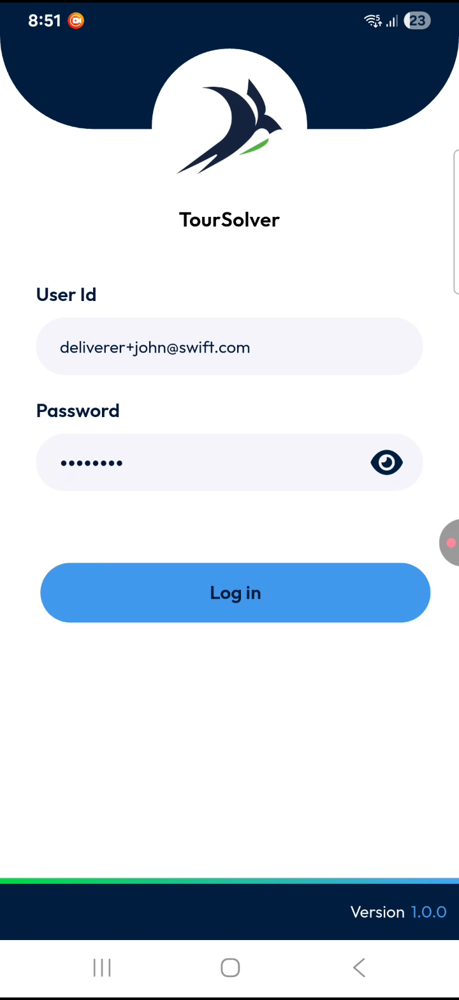

# Iniciar sesión

### Comenzando

Para garantizar la mejor experiencia con la aplicación Nomadia TourSolver, por favor verifique los requisitos del sistema para su dispositivo.

* **Requisitos del sistema** La aplicación Nomadia TourSolver está diseñada para ejecutarse en varios dispositivos móviles. Para asegurar la mejor experiencia, por favor compruebe si su dispositivo cumple los siguientes requisitos:
  * **Android** los dispositivos deben estar ejecutando **versión 8 a 14**.
  * **iOS** (Apple) los dispositivos deben estar ejecutando **versión 15.5 o posterior**.
* **Pasos de instalación y configuración** ¡Obtener la aplicación Nomadia TourSolver en su dispositivo es rápido y fácil!
  1. **Descargar la aplicación**: Puede descargar la aplicación Nomadia TourSolver desde **App Store de iOS** (para dispositivos Apple) o desde la **Google Play Store** (para dispositivos Android).
  2. **Iniciar la aplicación**: Después de descargarla, busque el **icono de TourSolver** en la pantalla principal de su dispositivo y **toque sobre él** para abrir la aplicación.

.png>)

* **Configuración inicial: descripción de la pantalla de inicio de sesión** Cuando inicie la aplicación por primera vez, siempre verá la **pantalla de inicio de sesión**. Esta pantalla es donde ingresará su información para acceder a la aplicación. Incluye varios elementos clave:
  * **Campo de ID de usuario**: Aquí es donde escribirá su identificación de usuario única.
  * **Campo de contraseña**: Aquí es donde ingresará su contraseña secreta.
  * **Botón azul de inicio de sesión**: Ubicado en el centro de la pantalla, tocará este botón después de ingresar sus datos.
  * **Número de versión de la aplicación**: Lo encontrará mostrado en la esquina inferior derecha de la pantalla.

### Explicaciones de funciones con beneficios

* **Interruptor de visibilidad de contraseña (icono de ojo)** El **el campo de contraseña** presenta un conveniente **icono de ojo**. Esta función le permite **alternar la visibilidad de su contraseña escrita**. Esto significa que puede ver temporalmente los caracteres que está escribiendo para asegurarse de que no haya cometido errores, y luego ocultarlos de nuevo por seguridad.
  * que indica el estado actual (consulte la Leyenda de colores en el menú de filtros). **Consejo**: Use el icono de ojo para verificar dos veces su contraseña antes de tocar **Iniciar sesión**, ¡especialmente si tiene problemas para iniciar sesión!

### Tareas comunes con pasos detallados

* **Iniciar sesión en la aplicación** El mapa mostrará: **el ID de usuario y la contraseña** son establecidos por su **administrador de back office de TourSolver**. Si alguna vez necesita **cambiar su contraseña**, por favor **contacte a su administrador** directamente. Así es como iniciar sesión:
  1. **Ingrese su información**: Toque el **campo de ID de usuario** y escriba su ID de usuario. Luego, toque el **campo de contraseña** y escriba su contraseña.
  2. **Toque Iniciar sesión**: Una vez que ambos campos estén completos, **toque el botón azul Iniciar sesión**.

3. **Inicio de sesión exitoso**: Si su ID de usuario y contraseña son correctos, será **autenticado con éxito e ingresará en la aplicación**.

* **Solución de problemas: inicio de sesión incorrecto** A veces, puede cometer un error tipográfico u olvidar su contraseña. ¡No se preocupe, la aplicación se lo hará saber!
  * Si el **nombre de usuario o la contraseña que ingresó es incorrecto**, aparecerá un mensaje de error que dice "**Nombre de usuario o contraseña incorrectos**". Este mensaje se mostrará entre el campo de contraseña y el botón de inicio de sesión.
  * ⚠️ **Advertencia**: Si ve este mensaje, verifique su ID de usuario y contraseña en busca de errores tipográficos y asegúrese de que la tecla Bloq Mayús no esté activada por accidente.

### Consejos de productividad

* que indica el estado actual (consulte la Leyenda de colores en el menú de filtros). **Gestión de contraseñas**: Recuerde siempre que su **administrador de back office de TourSolver** es el contacto principal para cualquier cambio o problema con la contraseña. No dude en comunicarse con ellos si tiene problemas persistentes para iniciar sesión.
* que indica el estado actual (consulte la Leyenda de colores en el menú de filtros). **Verificación rápida**: Use el **icono de ojo** junto al campo de contraseña para verificar rápidamente la entrada de su contraseña antes de tocar **Iniciar sesión**. Esto puede ahorrarle tiempo si tiende a cometer errores tipográficos.
