# Recogida

### 1. Primeros pasos

Para comenzar a usar la aplicación TourSolver Mobile, siga estos pasos.

#### Requisitos del sistema e instalación

Tenga en cuenta que requisitos específicos **del sistema** y **pasos de instalación/configuración** para la aplicación TourSolver Mobile no están detallados en las fuentes proporcionadas. Es posible que necesite consultar documentación adicional o a su administrador de TI para obtener esta información.

#### Iniciar una intervención

1. Una vez que la aplicación esté instalada y esté listo para comenzar su trabajo, iniciar una intervención es sencillo:

2. A **aparecerá un** popup de confirmación.

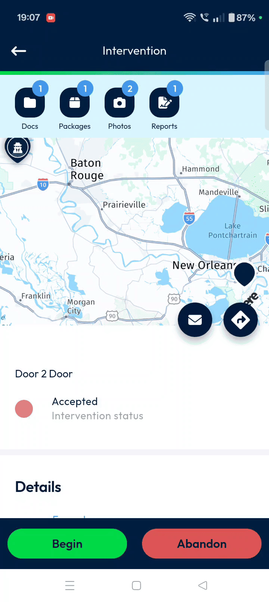

***

### 2. Funciones clave y beneficios

La interfaz de la aplicación TourSolver Mobile está diseñada para una navegación rápida y actualizaciones en tiempo real.

**Marcador de guía visual:**

* **Descripción general de la pantalla principal de intervención**: Este elemento visual mostraría la pantalla principal de la intervención, destacando la fila de iconos de navegación en la parte superior, los iconos de acceso rápido y la sección de detalles de la intervención. Esto proporcionaría una visión útil de la interfaz descrita a continuación.

#### Secciones de navegación (iconos en la parte superior)

Justo debajo de los iconos principales de navegación, encontrará una fila de iconos que le permiten saltar fácilmente entre diferentes partes de su intervención. Cada icono puede mostrar una pequeña **insignia azul** indicando el número de elementos agregados a esa sección, dándole una vista rápida de su progreso.

* **Documentos**: Aquí, puede **subir y ver documentos importantes** relacionados con su intervención. Esto mantiene todo el papeleo necesario organizado y accesible.
* **Paquetes**: Esta sección le permite **gestionar la carga y descarga de paquetes**, crucial para tareas de recogida.
* **Fotos**: Fácilmente **tomar o subir imágenes** directamente desde el campo, perfecto para capturar prueba de entrega o las condiciones del lugar.
* **Observaciones**: Utilice esta área para **ingresar cualquier comentario o nota** pertinente a la intervención.
* **Informes**: Aquí es donde puede **subir el informe oficial de la intervención**.
* **Firma**: Capture el **reconocimiento o la firma del cliente** directamente en su dispositivo.

<figure><figcaption></figcaption></figure>

#### Herramientas de acceso rápido

Debajo de los iconos principales de navegación, verá la **insignia del globo** y dos iconos de acceso rápido para acciones inmediatas.

* **Insignia del globo**: Esta insignia proporciona una vista rápida de su **contexto geográfico actual**, mostrándole exactamente dónde se encuentra la intervención.
* **Icono de correo**: Toque esto para **enviar rápidamente actualizaciones o contactar a las partes relevantes**.

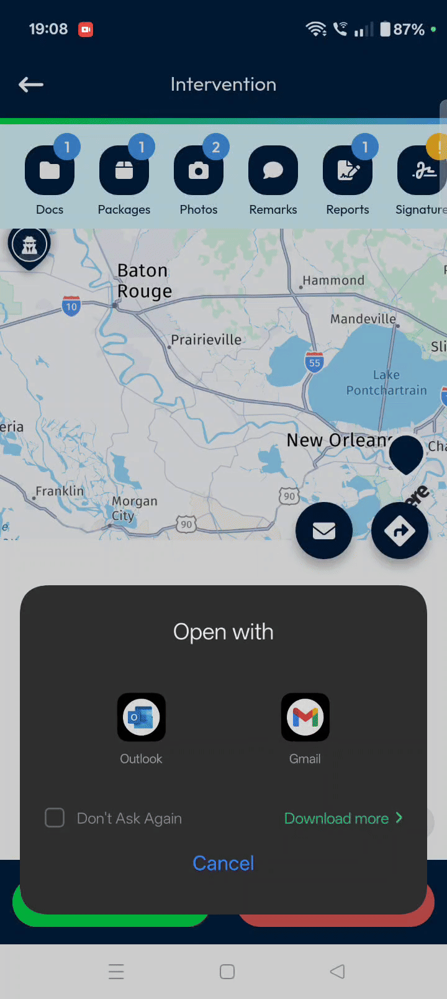

* **Botón de navegación**: Ubicado junto al icono de correo, al tocar esto se abre su **aplicación de mapas preferida**, proporcionando orientación de ruta instantánea hasta el sitio de la intervención.

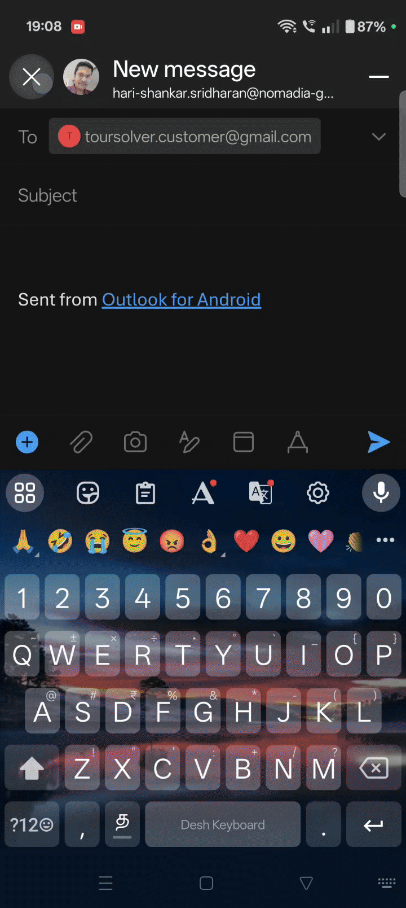

#### Detalles de la intervención

Debajo de estos iconos, encontrará detalles esenciales sobre su intervención actual:

* **Información clave**: Incluye el **título de la intervención**, su **estado**, **hora de inicio**, **hora de finalización**, y un **temporizador**.
* **Detalles adicionales**: Proporciona información más específica como el **nombre del sitio**, **dirección**, **título de la intervención**, **fecha y hora**, **hora anunciada de llegada**, **duración estimada**, **nombres de los participantes**, y **referencia externa**.

***

### 3. Instrucciones paso a paso

Esta sección le guía a través de las acciones más frecuentes que realizará dentro de la aplicación TourSolver Mobile.

#### Gestión de documentos (sección Documentos)

La sección Documentos le permite manejar todo el papeleo necesario de forma digital.

1. Toque **Documentos** para subir documentos relevantes.
2. Para ver un documento, simplemente tóquelo para abrirlo.

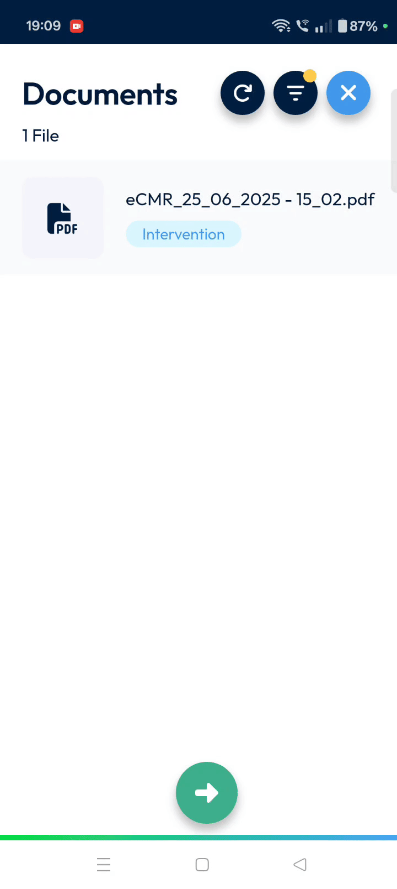

💡 **Consejo**: Use el **icono de filtro** en la parte superior para ordenar su lista de documentos por intervención o sitio, ayudándole a encontrar documentos específicos más rápido. Después de seleccionar su filtro, recuerde tocar **Aplicar**.

#### Escaneo y gestión de paquetes (sección Paquetes)

Esto es crucial para una gestión precisa de recogidas.

<figure><figcaption></figcaption></figure>

<figure><figcaption></figcaption></figure>

1. Verá información como: **Fecha y hora en que el cliente recogió**, **Fecha y hora en que se entregó al cliente**, **nombre del pedido**, y **nombre y dirección del cliente**.
2. También puede ingresar cualquier **observación** en el **cuadro de comentarios** provisto.
3. Toque el botón Guardar en la parte inferior para actualizar los cambios.

**Marcador de guía visual:**

* **Escaneo de paquetes y detalles**]: Este visual podría mostrar la interfaz de escaneo de paquetes con un círculo verde que indica un escaneo exitoso, y luego una vista detallada de una tarjeta de paquete con sus campos de información. Esto aclara el proceso de escaneo y entrada de datos.

#### Captura y subida de fotos (sección Fotos)

Documente su trabajo con imágenes claras.

1. Toque el **escáner** para escanear el código QR

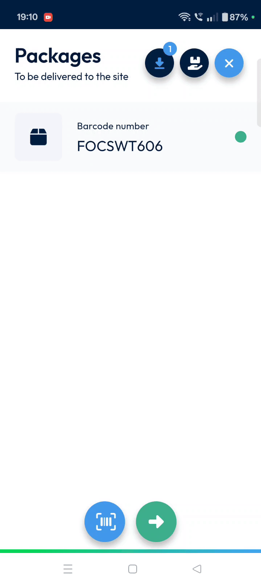

2. Una vez escaneado, el número de código de barras aparecerá junto con un círculo verde a su lado."

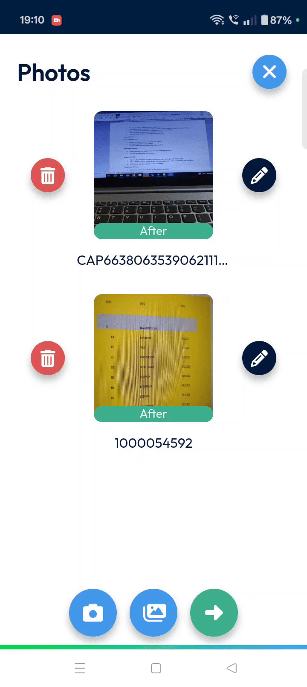

Toque el icono de

#### Captura y subida de fotos (sección Fotos)

1. Documente su trabajo con imágenes claras.

2. Toque **Cámara** para tomar una foto

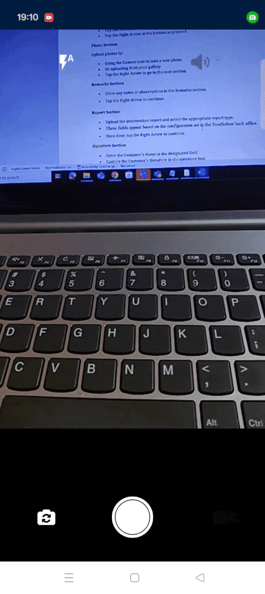

3. Seleccione la **marca de verificación** para confirmar y subir la foto."

4. Toque **icono de** foto para subir una imagen desde la galería

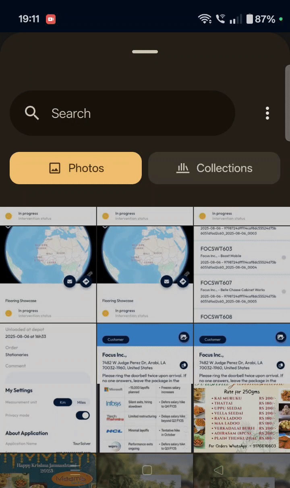

5. Toque **Guardar** para actualizar los cambios

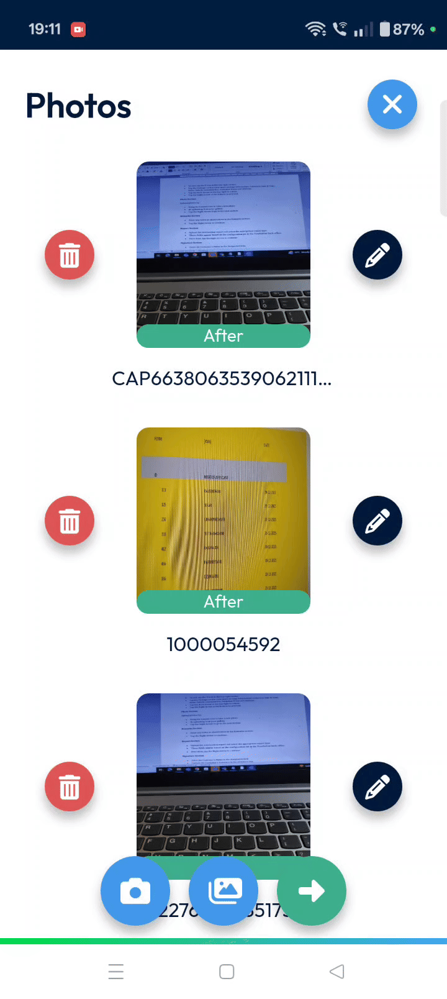

#### Agregar observaciones generales (sección Observaciones)

Proporcione contexto o notas importantes para la oficina central.

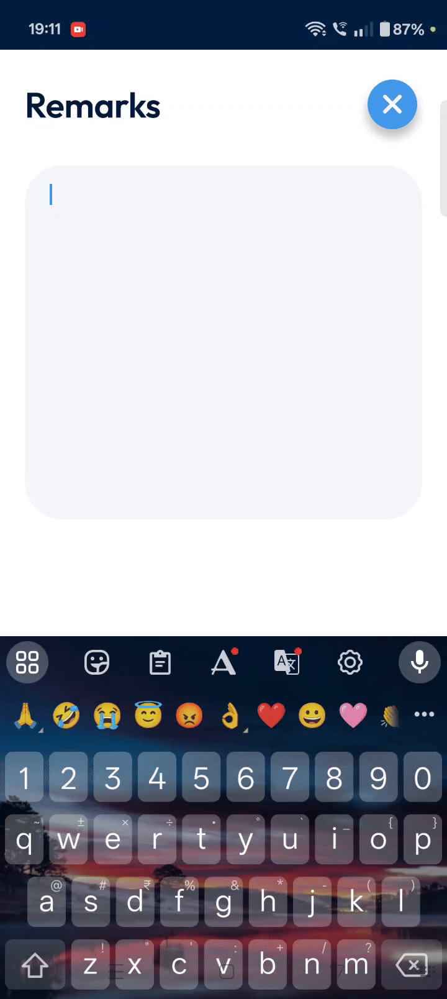

#### Subida de informes de intervención (sección Informes)

Complete su documentación oficial.

1. **Suba el informe de la intervención.**

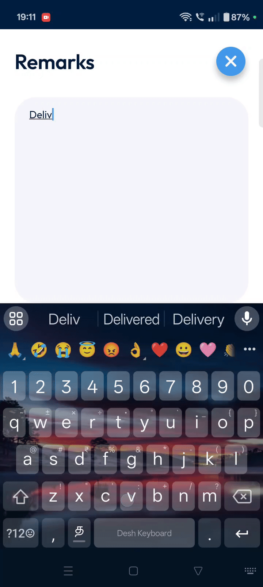

2. **Seleccione el tipo de informe apropiado**.

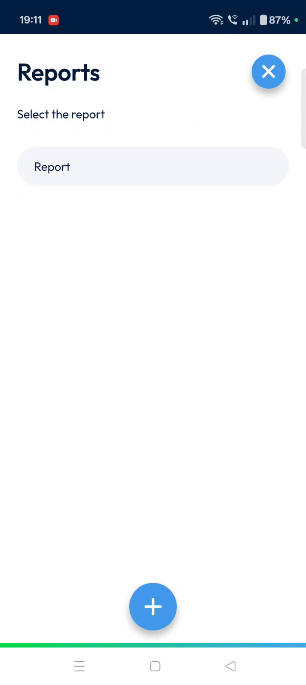

\
3\. **Complete los detalles necesarios bajo la opción de informe correspondiente. Los campos mostrados aquí dependen de la configuración establecida en la oficina central**

<figure>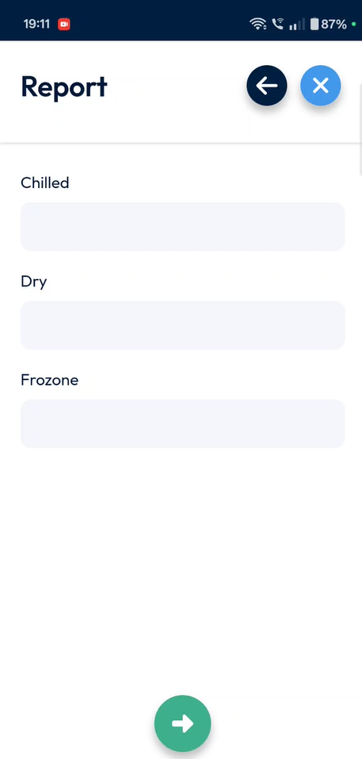<figcaption></figcaption></figure>

#### Captura de firmas de clientes (sección Firma)

Asegure el reconocimiento del cliente fácilmente.

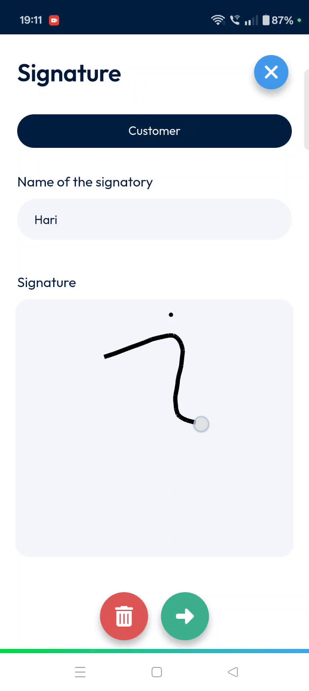

**Marcador de guía visual:**

* \[**Captura de pantalla/diagrama sugerido 3: Captura de firma**]: Este elemento visual mostraría la pantalla de captura de firma con el campo del nombre del cliente y el recuadro de firma, demostrando cómo se recopilan los reconocimientos.

#### Finalizar la intervención

1. Finalice su trabajo y sincronícelo con la oficina central.

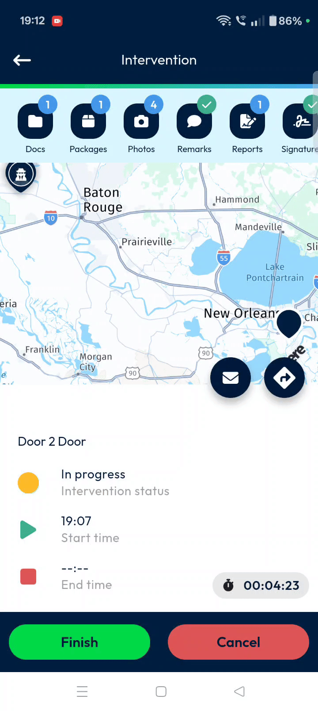

2. A **aparecerá un** popup de confirmación.

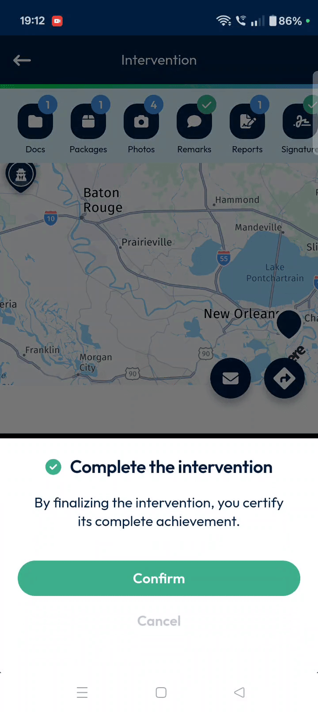

3. Una vez que toque **confirmar**, el estado cambiará a completado

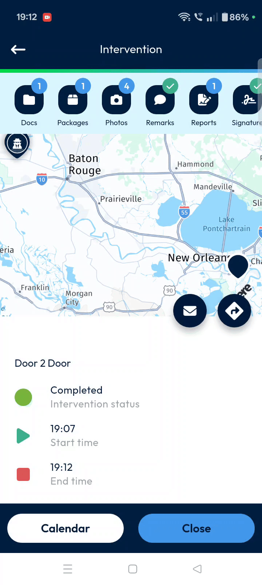

### 4. Consejos de productividad

* **Manténgase informado con las insignias**: Mantenga un ojo en las **pequeñas insignias azules** en cada icono. Le indican rápidamente cuántos elementos (documentos, fotos, paquetes) ha agregado a cada sección, ayudándole a seguir su progreso de un vistazo.
* **Use el acceso rápido para comunicarse**: No olvide el **icono de correo** para comunicación rápida. Esto puede ahorrarle tiempo cuando necesita enviar una actualización rápida o contactar a alguien directamente desde el sitio de la intervención.
* **Navegue de forma eficiente**: El **botón de navegación** es su mejor aliado para llegar a su próximo sitio. Se integra con su aplicación de mapas preferida, asegurando que siempre tenga la ruta más eficiente.
* **Los registros detallados son clave**: Haga buen uso de la **sección Observaciones** y el **cuadro de comentarios** dentro de los detalles del paquete. Las notas detalladas proporcionan contexto valioso para su equipo y ayudan a resolver cualquier consulta futura.
* **Verifique la configuración de la oficina central**: Recuerde que los campos de los informes se basan en **las configuraciones de la oficina central de TourSolver**. Si encuentra campos inesperados o necesita tipos de informes específicos, es buena idea consultar con su equipo de oficina central.

Al seguir esta guía, podrá gestionar y completar intervenciones paso a paso dentro de la aplicación TourSolver Mobile con confianza, ¡haciendo su trabajo más eficiente y preciso!
