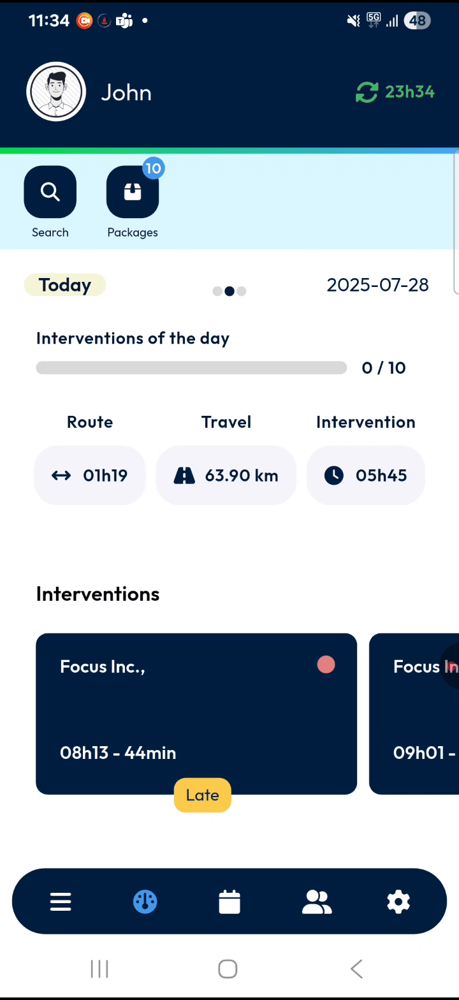
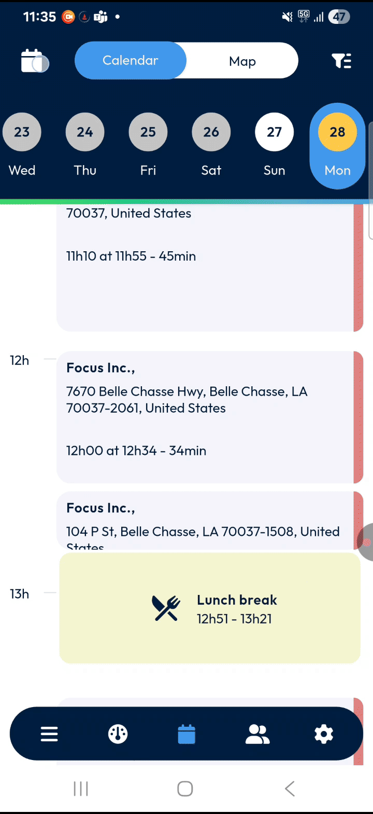
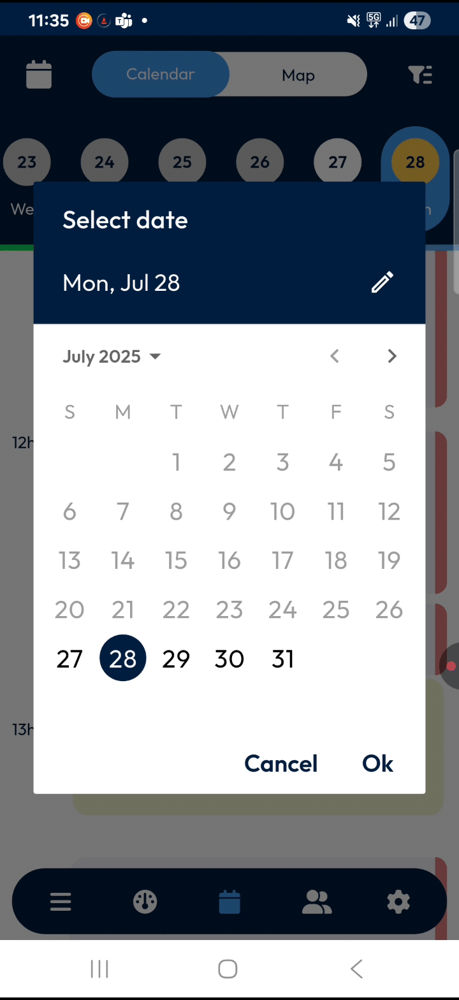
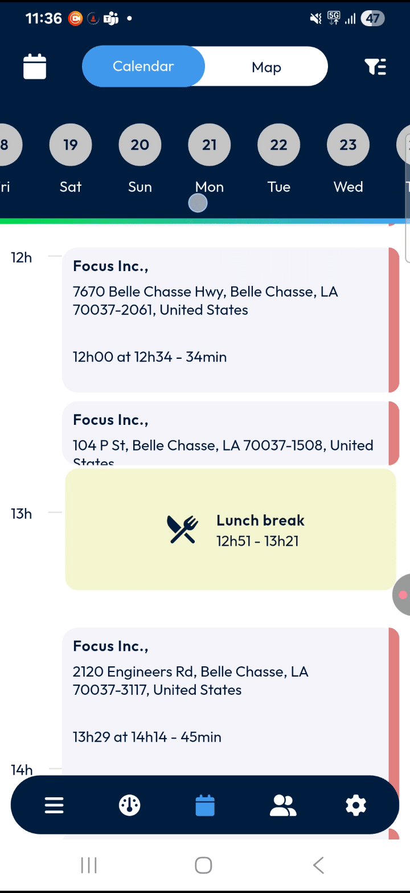
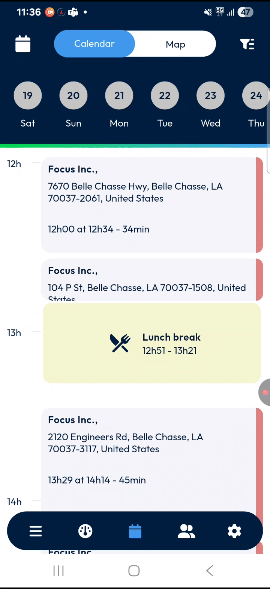
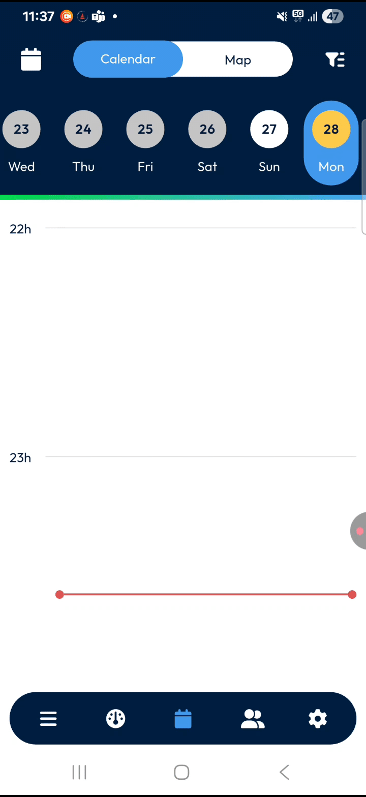
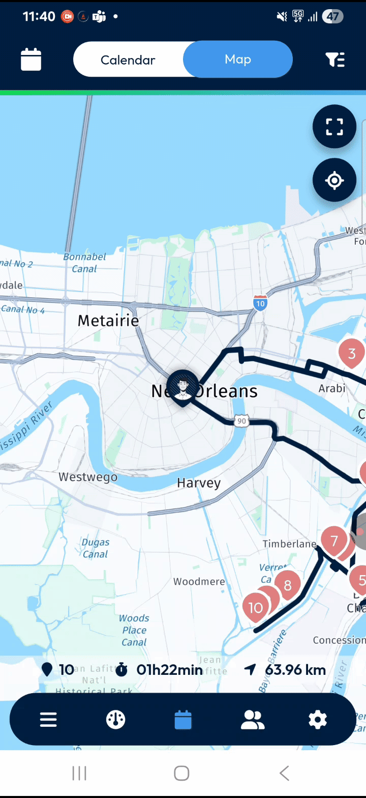
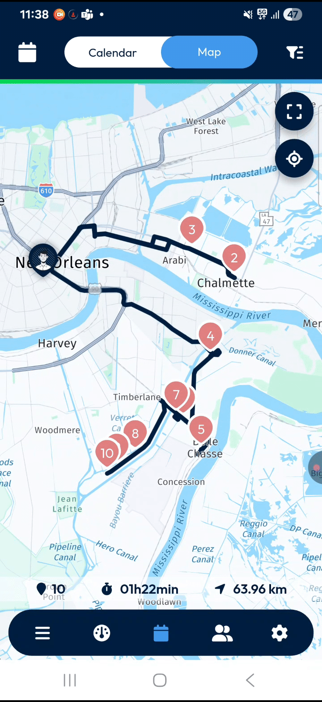

# Calendario

### 1. Comenzando&#x20;

La pantalla del calendario es su centro principal para ver y gestionar todas sus actividades planificadas, ya sea para hoy o para el futuro.

* **Requisitos del sistema e instalación/configuración:** Las fuentes proporcionadas no especifican los requisitos del sistema ni pasos detallados de instalación/configuración para la aplicación TourSolver Mobile. Consulte con el departamento de TI de su organización o la ficha de la app en la tienda para obtener esta información.
* **Configuración inicial: Abrir el calendario** Su recorrido comienza desde el panel principal de la aplicación.
  1. Busque los botones de acción principales en la **parte inferior** de la pantalla de la aplicación.
  2. **Toque** el **botón del calendario**.

### 2. Explicación de funciones y beneficios

El calendario de TourSolver Mobile ofrece potentes funciones para mantenerlo organizado y eficiente.

* **Vista diaria (predeterminada):**
  * **Beneficio:** Proporciona una visión inmediata del horario del día actual, incluidas las intervenciones con clientes y eventos como almuerzo o reuniones informativas.
  * **Detalles:** Muestra las intervenciones como **tarjetas**. Una línea horizontal roja muestra la línea de tiempo actual, ayudándole a ver en qué parte del día se encuentra.
* **Selección de fecha:**
  * **Beneficio:** Le permite ver fácilmente las intervenciones de una fecha específica, pasada (si está habilitada) o futura.
  * **Detalles:** Accesible a través del **icono de calendario** en la parte superior izquierda de la pantalla del calendario.
* **Vista de calendario (tarjetas):**
  * **Beneficio:** Presenta una vista clara, tipo lista, de todas las intervenciones para una fecha seleccionada, detallando la información del cliente y los horarios.
  * **Detalles:** Cada intervención se muestra como una **tarjeta**, mostrando el nombre del cliente, la dirección, las horas de inicio/fin y la duración. Un pequeño círculo de color en la derecha indica el estado actual de la intervención. También se enumeran eventos como "pausa para almuerzo", "reunión informativa", "carga" y "descarga".
* **Vista de mapa:**
  * **Beneficio:** Ofrece una visión visual de su ruta diaria y la ubicación de cada intervención, ayudándole a comprender su plan de viaje.
  * **Detalles:** Muestra su ubicación de inicio y todas las intervenciones del día, numeradas en secuencia. Un resumen de la ruta muestra el número de intervenciones, la duración total y la distancia a recorrer. También puede ver las tarjetas de intervención junto al mapa en modo de pantalla completa.
* **Filtros y opciones de visualización:**
  * **Beneficio:** Personalice cómo ve su agenda, permitiéndole cambiar entre vistas de día, semana o lista y acceder a acciones importantes.
  * **Detalles:** Accesible a través del **botón de filtro** en la parte superior derecha de la pantalla.
* **Leyenda de colores del estado de la intervención:**
  * **Beneficio:** Entienda rápidamente el estado de cada intervención de un vistazo según su color.
  * **Detalles:** La leyenda de colores es accesible tocando el **botón de filtro**.
    * **Rojo:** Estado en espera.
    * **Rojo claro:** Estado aceptado (esto también se indica si una tarjeta dice "su próxima visita" como su próxima acción).
    * **Amarillo:** En progreso.
    * **Verde:** Completado.
    * **Púrpura oscuro:** Rechazado.
    * **Púrpura claro:** Abandonado.

***

### 3. Instrucciones paso a paso

Aquí se explica cómo realizar acciones clave dentro del Calendario de TourSolver Mobile.

**3.1. Cambiar la fecha de vista** Para ver su agenda de un día diferente:

1. Desde la pantalla del calendario, toque el **icono de calendario** en la **parte superior izquierda**.

2. Se mostrará el mes actual con la fecha de hoy resaltada.
3. Tiene varias opciones para elegir otra fecha:

4\. Una vez que haya elegido su fecha, toque **Aceptar** para confirmar su selección o **Cancelar** para cerrar la ventana emergente sin cambiar la fecha.

**3.2. Cambiar entre las vistas de Calendario y Mapa** Puede elegir cómo desea visualizar sus intervenciones:

1. En la parte superior central de la pantalla, junto al icono del calendario, verá dos iconos de vista.
2. **Toque** toque el icono correspondiente para cambiar:

**3.3. Uso de filtros y opciones de visualización** Para refinar su vista o acceder a acciones:

1. Toque el **botón de filtro** en la **en la parte superior derecha** de la pantalla.

2. Desde este menú, puede cambiar entre Semana, Día y Lista

**3.4. Ver detalles de la intervención en la vista de tarjetas**

1. Una vez configurados sus filtros, desplácese hacia abajo para ver todas sus intervenciones para la fecha seleccionada.
2. Cada intervención aparece como una **tarjeta**.
3. En cada tarjeta verá:
   * El **nombre** del cliente **y**.
   * dirección **Horas de inicio y fin de la** del cliente **intervención**.
   * duración **Un pequeño** círculo de color
     * que indica el estado actual (consulte la Leyenda de colores en el menú de filtros). **💡** Consejo:**Si una tarjeta dice "**&#x53;u próxima visita
4. ", significa su próxima acción inmediata. **Para ver más detalles y comenzar una tarea,** toque
   * una tarjeta de intervención.

**\[Captura de pantalla: Tarjeta de intervención de ejemplo con detalles resaltados]** 3.5. Explorando la vista de mapa

1. Toque el **Para una visión visual de su ruta:** icono de vista de mapa
2. en la parte superior central de la pantalla.
   * El mapa mostrará: **Su**.
   * ubicación de inicio **Cada intervención del día,**.
   * numeradas en orden **Un** resumen de la ruta
   * El mapa mostrará: **incluyendo el número de intervenciones, la duración total y la distancia a recorrer.** ruta trazada
3. **en el mapa.**

**Vista de mapa en pantalla completa:** 3.6. Volver a la pantalla principal del calendario **Siempre puede volver a la pantalla principal del calendario tocando la** en la **parte superior izquierda**.

***

### flecha de retroceso

4\. Consejos de productividad

* **💡 La pantalla del calendario está diseñada para ayudarle a ver y gestionar rápidamente las intervenciones para cualquier fecha, hoy o en el futuro.** Manténgase actualizado: **Use regularmente la** "Actualizar mi agenda" **función (se encuentra bajo el**botón de filtro > Acciones
* **) para asegurar que su calendario refleje los últimos cambios de su planificador. Esto es crucial para una programación precisa.** Búsqueda rápida: **Si necesita encontrar una intervención específica, ¡no se desplace sin fin! Use la** "Buscar una intervención" **función (se encuentra bajo el**herramienta (también bajo
* **) para localizarla rápidamente escribiendo un nombre, número, fecha o dirección.** Planificación visual: **Aproveche la** Vista de mapa
* **para comprender su ruta diaria y la distribución geográfica de sus intervenciones. Esto puede ayudarle a anticipar los tiempos de viaje y optimizar su secuencia de visitas.** Estado de un vistazo: **Familiarícese con la** leyenda de colores
