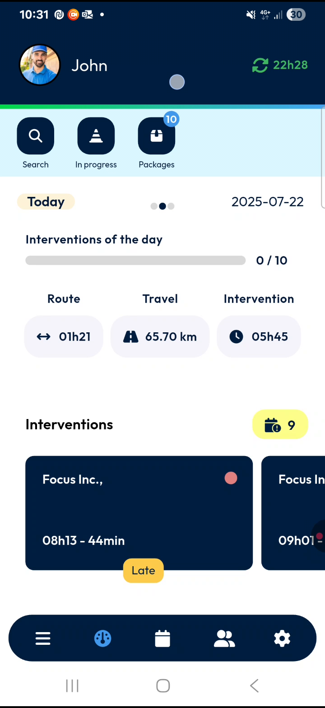
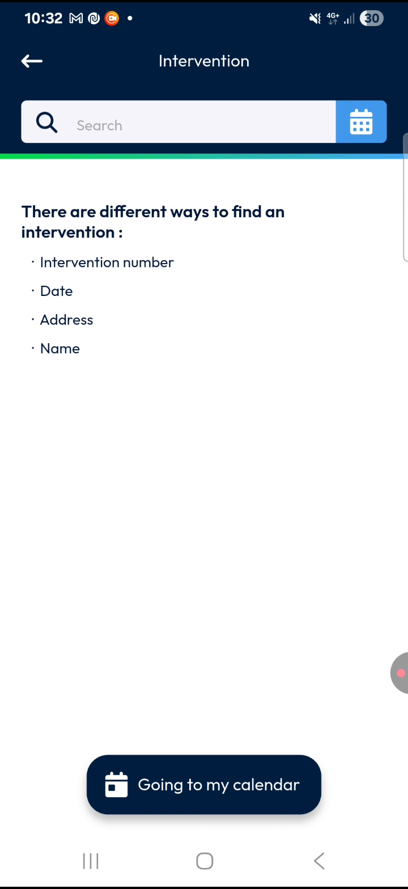
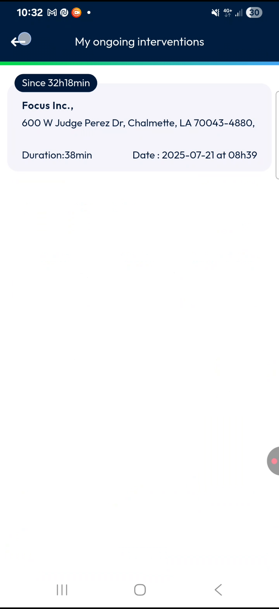
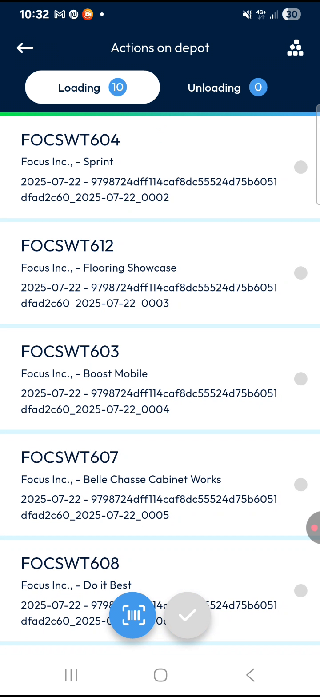
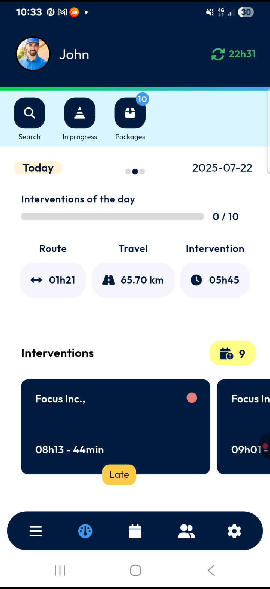
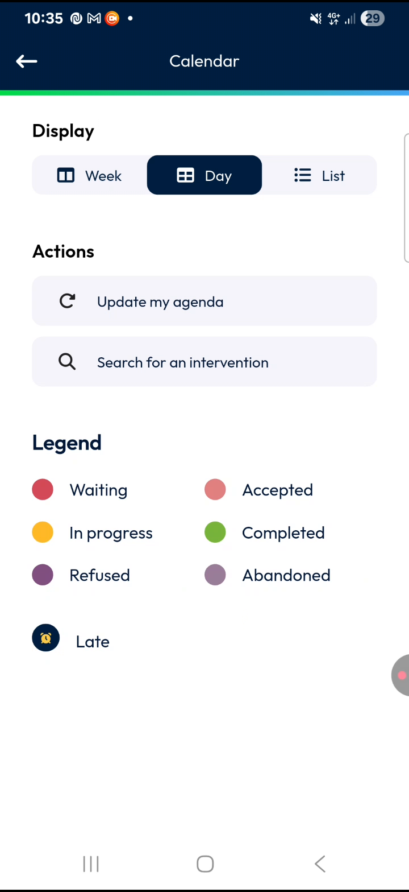
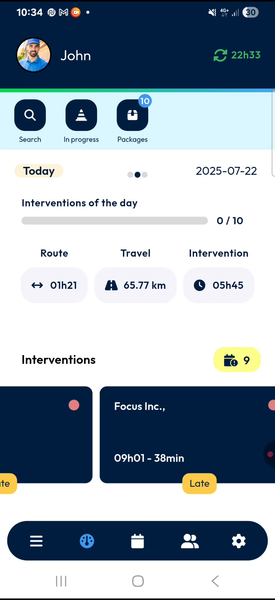

# Tablero

### 1. Primeros pasos

Tras iniciar sesión con éxito, verás de inmediato tu **Tablero** pantalla. Esta pantalla está diseñada para ofrecerte una vista rápida de las actividades del día.

* **Vista inicial después de iniciar sesión**: Cuando inicies sesión por primera vez, tu tablero mostrará tu horario y progreso. Por ejemplo, el **Barra de progreso** podría mostrar "0 de 10", lo que significa que tienes 10 intervenciones programadas para hoy y ninguna ha sido completada aún. Esta barra se actualizará automáticamente a medida que completes tareas durante el día.

### 2. Explicación de funciones con beneficios

El tablero de TourSolver Mobile está repleto de funciones útiles diseñadas para ayudarte a gestionar tu día de manera eficaz.

* **Sección superior: Tu perfil y estado de los datos**
  * **Avatar y nombre**: En el **esquina superior izquierda**, verás tu **foto de perfil (avatar)** y tu **nombre** mostrado junto a ella.
    * **Beneficio**: Esto confirma que has iniciado sesión y ayuda a personalizar tu experiencia.

* **Hora de sincronización**: En el **esquina superior derecha**, puedes ver la **última vez que la aplicación se sincronizó con éxito con la oficina central**.
  * **Beneficio**: Esto te indica cuán actualizados están tus datos, asegurando que trabajes con la información más reciente.

* **Botones de acción rápida: Tus herramientas diarias** Justo debajo de la sección superior, estos botones ofrecen acceso rápido a funciones importantes:
  * **Buscar**: Este botón te permite **encontrar rápidamente cualquier intervención** ingresando un nombre de cliente, un número, una fecha o una dirección.
    * **Beneficio**: Ahorra tiempo ayudándote a localizar tareas específicas sin tener que desplazarte por toda tu agenda.

* **Intervenciones en progreso**: Este botón muestra una **lista de tus intervenciones que están actualmente en progreso**.
  * **Beneficio**: Te ayuda a concentrarte en las tareas en las que estás trabajando activamente.
    * 💡 **Consejo**: Este botón solo aparece si tienes intervenciones marcadas actualmente como "en progreso".

* **Cargar paquetes**: Este botón se usa para **cargar todos los paquetes de entrega en tu camión** antes de comenzar tu ruta del día.
  * **Beneficio**: Garantiza que tengas todos los elementos necesarios listos antes de comenzar tus tareas diarias.

* **Carrusel de agenda: Tu horario de un vistazo** Debajo de los botones de acción rápida, encontrarás un **carrusel de agenda**.
  * Esto muestra tu **horario para hoy**.
  * Puede **desliza hacia la derecha** para ver la agenda de ayer o **desliza hacia la izquierda** para ver la agenda de mañana.
  * La **día** (p. ej., "hoy", "ayer" o "mañana") se muestra en el **lado izquierdo** del carrusel.
  * La **fecha real** para el día seleccionado se muestra en el **lado derecho**.
  * **Beneficio**: Proporciona una vista clara y flexible de tu horario para el día actual, pasado o próximo.

* **Barra de progreso: Seguimiento de tu cumplimiento diario** Debajo del carrusel de agenda, la **barra de progreso** representa visualmente **cuántas intervenciones has completado hoy**.
  * A medida que completas intervenciones, esta barra se actualiza automáticamente en tiempo real.
  * **Beneficio**: Ofrece una actualización visual inmediata de tu progreso, ayudándote a mantener la motivación y el rumbo.

* **Resumen de ruta: Resumen de tu carga de trabajo** Justo debajo de la barra de progreso, el **Un** proporciona tres piezas clave de información para tu día:
  * **Ruta**: El **distancia total** que recorrerás hoy.
  * **Viaje**: El **kilómetros totales planificados** para el día.
  * **dirección**: El **duración total de las intervenciones** planeadas para el día.
  * **Beneficio**: Te da una visión rápida y esencial de tu carga de trabajo diaria, ayudándote a comprender el alcance de tus tareas.

* **Sección de intervenciones: Detalles de tus tareas** Al desplazarte hacia abajo, entrarás en la **sección de intervenciones** donde todas las tareas del día se muestran como **tarjetas individuales**.
  * Puede **desliza estas tarjetas de derecha a izquierda** para navegar por todas tus intervenciones programadas.
  * A la derecha de la etiqueta "Intervención", verás un conteo de **cuántas intervenciones están retrasadas hoy**. Por ejemplo, podría mostrar "nueve intervenciones están retrasadas hoy".
  * Cada **tarjeta de intervención** muestra detalles importantes:
    * La **nombre del cliente**.
    * La **hora programada** para esa intervención.
    * La **duración estimada** de la intervención.
  * **Círculo coloreado**: Un pequeño **Un pequeño** en la esquina superior derecha de cada tarjeta representa el **estado actual de la intervención** (por ejemplo, completada, aceptada).
    * **Beneficio**: Proporciona una señal visual rápida del estado de la tarea.
    * 💡 **Consejo**: Puedes encontrar la **leyenda de estos colores** en el **menú del calendario** bajo la **opción de filtro**.

* **Bandera de retraso**: Si una tarea está retrasada, verás una pequeña **bandera rectangular amarilla "retrasada"** en la parte inferior central de la tarjeta.
  * **Beneficio**: Resalta inmediatamente las tareas vencidas, ayudándote a priorizarlas.

* **Beneficio**: Ofrece una vista completa y detallada de cada tarea, facilitando ver toda la información necesaria de un vistazo.

* **Botones de navegación principales: Desplazarse por la aplicación** En la parte inferior del tablero, encontrarás los **botones del menú principal**. Estos te permiten cambiar fácilmente entre diferentes pantallas de la aplicación, incluyendo:
  * **Menú**
  * **Tablero**
  * **Calendario**
  * **Prospectos y clientes**
  * **Ajustes**
  * **Beneficio**: Proporciona una navegación fluida a lo largo de la aplicación TourSolver Mobile.

### 3. Instrucciones paso a paso

Aquí se explica cómo interactuar con algunas funciones clave en tu tablero:

* **Revisar tu horario para diferentes días**:
  1. Localice el **Carrusel de agenda** debajo de los botones de acción rápida.
  2. Para ver **el horario de ayer**, **desliza el carrusel hacia la derecha**.
  3. Para ver **el horario de mañana**, **desliza el carrusel hacia la izquierda**.
  4. El día y la fecha que se muestran en el carrusel se actualizarán para reflejar tu selección.

* **Navegar por tus intervenciones**:
  1. Desplázate hacia abajo hasta la **Sección de intervenciones**.
  2. Verás tus intervenciones programadas mostradas como tarjetas individuales.
  3. Para ver todas tus intervenciones del día, **desliza estas tarjetas de derecha a izquierda**.

* **Encontrar rápidamente una intervención específica**:
  1. Localice el **Botón de búsqueda** justo debajo de la información de tu perfil.
  2. **Toca el botón Buscar**.
  3. **Ingresa el nombre, número, fecha o dirección** de la intervención que estás buscando.
  4. La aplicación mostrará los resultados coincidentes, ayudándote a saltar rápidamente a la tarea deseada.

### 4. Consejos de productividad

* 💡 **Mantente sincronizado**: Revisa regularmente la **Hora de sincronización** en la esquina superior derecha. Una sincronización reciente significa que tus datos están actualizados, lo cual es crucial para gestionar tus tareas de manera efectiva.
* 💡 **Planifica con antelación o revisa el pasado**: Use el **Carrusel de agenda** para deslizar rápidamente entre hoy, ayer y mañana. Esto te ayuda a planear tu próximo día o revisar tareas completadas.
* 💡 **Prioriza las tareas retrasadas**: Mantén siempre un ojo en el **conteo de "retrasadas"** en la sección de intervenciones y en la **bandera amarilla "retrasada"** en las tarjetas de intervención individuales. Abordarlas con prontitud puede ayudar a mantener tu horario en orden.
* 💡 **Entiende el estado de un vistazo**: Familiarízate con los **círculos coloreados** en las tarjetas de intervención y sus significados consultando la **leyenda en el menú Calendario bajo la opción de filtro**. Esto permite una evaluación visual rápida del estado de cada tarea.
* 💡 **Aprovecha las acciones rápidas**: Haz uso de los **Buscar**, **Botones de máquinas en progreso**, y **Cargar paquetes** . Están diseñados para un acceso rápido a funciones esenciales y pueden aumentar significativamente tu eficiencia.

El tablero es tu herramienta definitiva para gestionar tus tareas diarias con confianza y eficiencia. Si necesitas información más detallada sobre alguna sección específica, consulta otras guías dedicadas.
