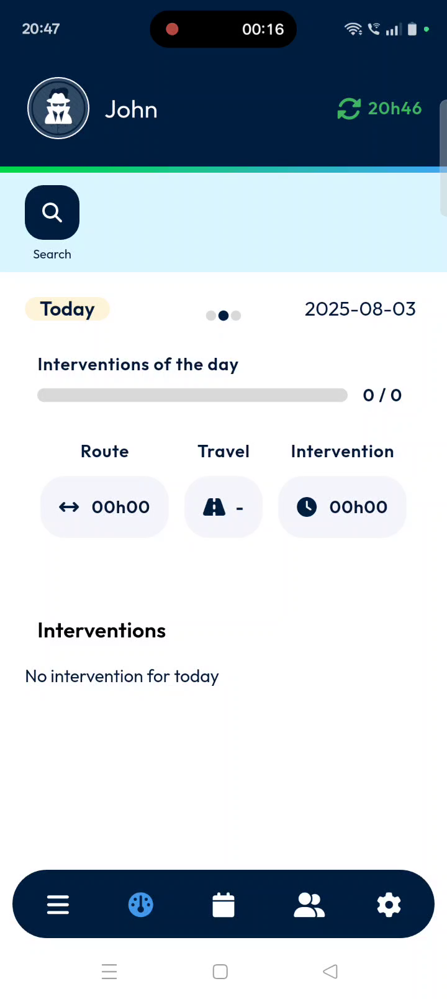
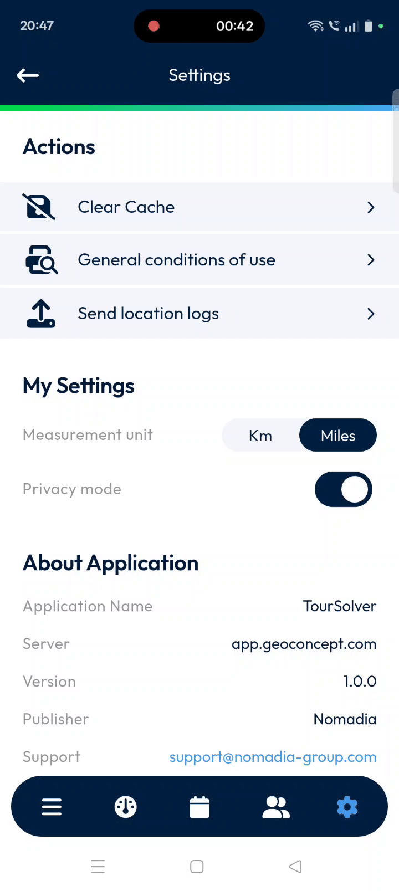
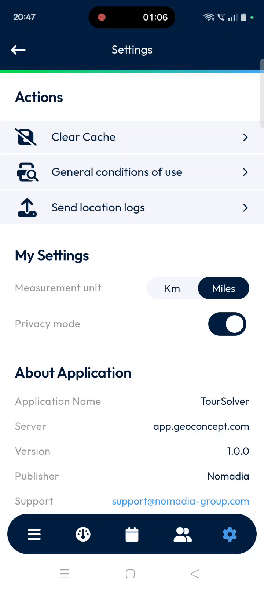
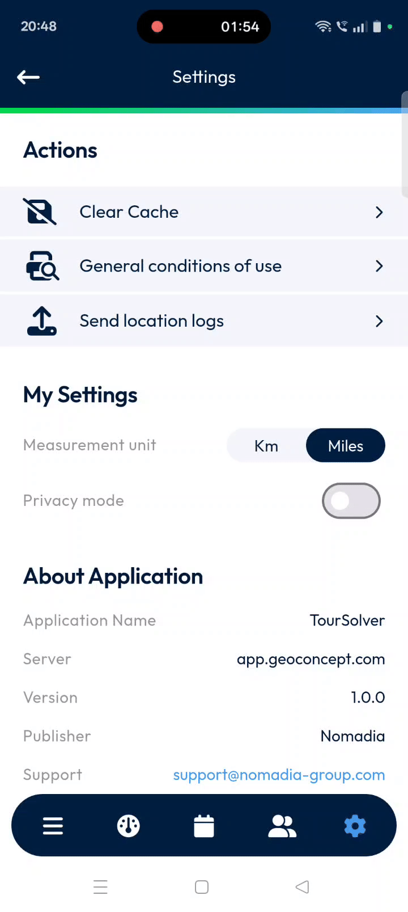

# Ajustes

### 1. Comenzando

Aunque las fuentes proporcionadas no especifican los requisitos exactos del sistema para la aplicación TourSolver Mobile ni sus pasos iniciales de instalación, esta sección le guiará sobre cómo acceder y realizar las configuraciones iniciales esenciales dentro de los ajustes de la aplicación.

**1. Acceder a la pantalla de Ajustes** Para acceder a los ajustes:

1. **Inicie la aplicación TourSolver Mobile**.
2. Localice el **icono de engranaje** en la barra de navegación inferior.
3. Toque el **icono de engranaje**.

4. Ahora estará en la **pantalla de Ajustes**. Aquí encontrará tres secciones principales: **Acciones**, **Mis Ajustes**, y **Acerca de la Aplicación**.
   * _Imagine una captura de pantalla aquí que muestre la pantalla principal de Ajustes con las tres secciones claramente etiquetadas._

**2. Configuración inicial (primeros pasos importantes)**

* **Establezca su unidad de medida preferida**:
  1. En la pantalla de Ajustes, navegue hasta la **Mis Ajustes** sección.
  2. Toque la opción "unidad de medida".
  3. Elija su unidad preferida seleccionando ya sea **Kilómetro** o **Millas** según su región o preferencia.

* **Habilite el Modo Privacidad para el control de datos**:
  1. En la pantalla de Ajustes, también bajo **Mis Ajustes**, encuentre la opción "Habilitar modo privacidad".
  2. **Active** esta opción para **restringir la recopilación de datos de la aplicación**.
  3. que indica el estado actual (consulte la Leyenda de colores en el menú de filtros). **Consejo**: Habilitar el modo privacidad es una excelente manera de asegurar que su información personal se maneje de acuerdo con **estándares GDPR**, dándole control total sobre cómo se comparte su información.

***

### 2. Comprender las características de su aplicación (Secciones de Ajustes)

La pestaña Ajustes organiza características valiosas en tres secciones fáciles de entender:

* **Acciones**: Esta sección ofrece opciones para gestionar el rendimiento de su aplicación y facilitar el soporte.
  * **Borrar Caché**: Esta opción ayuda a que su aplicación funcione sin problemas eliminando archivos temporales.
    * **Beneficio**: Optimiza el rendimiento y actualiza contenido obsoleto, asegurando que siempre vea la información más actual.
  * **Condiciones Generales de Uso**: Aquí, puede acceder y leer los avisos legales oficiales, términos y definiciones que se aplican en toda la aplicación.
    * **Beneficio**: Manténgase informado sobre sus derechos y responsabilidades al usar la aplicación.
  * **Enviar Registros de Ubicación**: Esta función le permite enviar de forma segura su historial de ubicaciones directamente al equipo de soporte.
    * **Beneficio**: Esencial para la resolución de problemas o fines de diagnóstico si encuentra algún inconveniente que requiera asistencia técnica.
* **Mis Ajustes**: Esta sección le permite personalizar su experiencia en la aplicación.
  * **Unidad de Medida**: Elija su unidad preferida para las mediciones de distancia.
    * **Beneficio**: Personalice la aplicación para mostrar las distancias en **kilómetros** o **millas**, haciéndola más conveniente y familiar para usted.
  * **Modo Privacidad**: Controle cómo la aplicación recopila sus datos personales.
    * **Beneficio**: Al habilitar esto, alinea el procesamiento de datos de la aplicación con **estándares GDPR**, garantizando que tenga control total sobre su información personal y cómo se comparte.
* **Acerca de la Aplicación**: Esta sección proporciona información técnica esencial sobre la aplicación TourSolver Mobile.
  * **Nombre de la Aplicación**: La aplicación se llama **TourSolver**.
  * **Servidor**: Sincroniza datos usando el servidor `apps.concept.com`.
  * **Versión**: Muestra la versión actual instalada, por ejemplo, `1.0.0`.
  * **Editor**: La aplicación es desarrollada y publicada por **Nomadia**, un líder reconocido en soluciones de movilidad inteligente.
  * **Soporte**: Proporciona la dirección de correo electrónico de soporte: `support@nomadiagroup.com` para cualquier asistencia.
  * **Sitio web**: Ofrece la dirección del sitio web oficial: `www.nomadiagroup.com` para más información.
    * **Beneficio**: Encuentre rápidamente detalles importantes sobre la aplicación, incluida la información de contacto para soporte, lo cual es útil para la resolución de problemas o consultas.

***

### 3. Tareas comunes en Ajustes

Aquí hay instrucciones paso a paso para acciones comunes que pueda querer realizar en la pestaña Ajustes:

* **Cómo borrar la caché de la aplicación**:
  1. En la pantalla de Ajustes, toque **Borrar Caché** bajo la **Acciones** sección.
  2. Aparecerá una ventana emergente de confirmación que preguntará "¿Está seguro de que desea borrar la caché de su aplicación?"

* **Cómo leer las Condiciones Generales de Uso**:
  1. En la pantalla de Ajustes, toque **Condiciones Generales de Uso** bajo la **Acciones** sección.
  2. Serás llevado a una nueva pantalla donde podrá leer los avisos legales completos, términos y definiciones.

* **Cómo enviar registros de ubicación al soporte**:
  1. En la pantalla de Ajustes, toque **Enviar Registros de Ubicación** bajo la **Acciones** sección.
  2. Después de tocar, aparecerá un mensaje de confirmación que indicará que "los registros fueron enviados con éxito."

* **Cómo cambiar su unidad de medida**:
  1. Desde la pantalla de Ajustes, localice la **Mis Ajustes** sección.
  2. Toque la opción para **unidad de medida**.
  3. Elija su unidad preferida seleccionando ya sea **Kilómetro** o **Millas** según su región o preferencia.

* **Cómo habilitar el Modo Privacidad**:
  1. Desde la pantalla de Ajustes, localice la **Mis Ajustes** sección.
  2. Encuentre la opción "Habilitar modo privacidad."
  3. **Active** el interruptor junto a esta opción para ponerlo **encendido** (para limitar la recopilación de datos) o **apagado**.

### flecha de retroceso&#x20;

* **Borrado regular de caché**: Haga el hábito de **Borrar Caché** periódicamente. Esto mantiene su aplicación rápida y receptiva, evitando ralentizaciones por la acumulación de archivos temporales.
* **Control de Datos**: Aproveche el **Modo Privacidad**. Si la privacidad de los datos es una preocupación, habilitar esta función le da un mayor control sobre cómo se maneja su información, alineándose con los estándares internacionales de privacidad.
* **Acceso rápido al soporte**: Si encuentra algún problema técnico, recuerde que la **Enviar Registros de Ubicación** función puede ser una forma rápida de proporcionar información de diagnóstico esencial al equipo de soporte. También puede encontrar la **dirección de correo de soporte** del cliente **sitio web** bajo "Acerca de la Aplicación" para asistencia directa.
* **Manténgase informado**: Revise periódicamente las **Condiciones Generales de Uso** para mantenerse actualizado sobre cualquier aviso legal o términos que rijan su uso de la aplicación.
